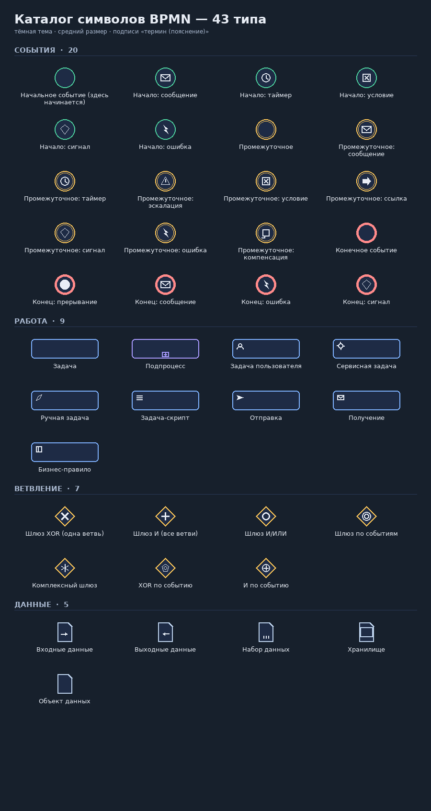
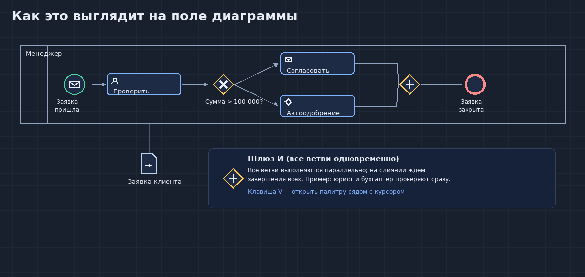

# Палитра BPMN V55 — что сделано и что нужно согласовать

Референсы: две таблицы BPMN 2.0 (13 типов событий и 7 типов шлюзов),
присланные пользователем 26.11.2026.

Решения пользователя, принятые до реализации:

| Вопрос | Решение |
|---|---|
| Где палитра | И постоянная панель слева, и колесо по клавише V |
| Подписи | «Термин (пояснение бытовыми словами)» |
| Размер | Средний: символы 40–44 px, подписи 11–13 px |
| Порядок работ | Шаг 1: 13 событий + 7 шлюзов + панель, затем палитра вариантов |

## Скриншоты

## Что уже в коде

| Файл | Назначение |
|---|---|
| `core/bpmn_catalog_v55.py` | 43 символа: подпись, подсказка, пример, группа |
| `core/bpmn_shapes_v55.py` | единый SVG-рендер для поля, палитры и колеса |
| `ui/pages/diagram_editor_v16.py` | палитра по группам, карточка-подсказка |
| `tests/test_bpmn_palette_v55.py` | 53 проверки, включая живой UI-тест |

Старые 13 кодов V39 сохранены: ранее сохранённые диаграммы открываются
без миграции данных.

## Соответствие таблицам-референсам

### События (таблица 1)

| Тип из таблицы | Начальное | Промежуточное | Конечное |
|---|---|---|---|
| Простое | `START_EVENT` | `INTERMEDIATE_EVENT` | `END_EVENT` |
| Сообщение | `START_MESSAGE` | `INTERMEDIATE_MESSAGE` | `END_MESSAGE` |
| Таймер | `START_TIMER` | `INTERMEDIATE_TIMER` | — (в BPMN нет) |
| Эскалация | — | `INTERMEDIATE_ESCALATION` | — |
| Условие | `START_CONDITIONAL` | `INTERMEDIATE_CONDITIONAL` | — |
| Ссылка | — | `INTERMEDIATE_LINK` | — |
| Ошибка | `START_ERROR` | `INTERMEDIATE_ERROR` | `END_ERROR` |
| Отмена | — | `INTERMEDIATE_CANCEL` ⚠️ | — |
| Компенсация | — | `INTERMEDIATE_COMPENSATION` | — |
| Сигнал | `START_SIGNAL` | `INTERMEDIATE_SIGNAL` | `END_SIGNAL` |
| Составное | `START_MULTIPLE` ⚠️ | `INTERMEDIATE_MULTIPLE` ⚠️ | — |
| Параллельное составное | `START_PARALLEL_MULTIPLE` ⚠️ | `INTERMEDIATE_PARALLEL_MULTIPLE` ⚠️ | — |
| Прерывание | — | — | `END_TERMINATE` |

⚠️ — ещё не реализовано, предлагается следующим пакетом (см. ниже).

### Шлюзы (таблица 2)

| Тип из таблицы | Код | Готово |
|---|---|---|
| «И» | `PARALLEL_GATEWAY` | ✅ |
| «ИЛИ» | `INCLUSIVE_GATEWAY` | ✅ |
| «Исключающее ИЛИ», управляемое данными | `EXCLUSIVE_GATEWAY` | ✅ |
| Комплексное условие | `COMPLEX_GATEWAY` | ✅ |
| «Исключающее ИЛИ», событийное | `EXCLUSIVE_EVENT_GATEWAY` | ✅ |
| «Исключающее ИЛИ», событийное, создающее экземпляр | ⚠️ | — |
| Событийное, создающее процесс «И» | `PARALLEL_EVENT_GATEWAY` | ✅ |

## Предложение: следующий пакет

1. **Отмена** (`INTERMEDIATE_CANCEL`) и **составные события**
   (`*_MULTIPLE`, `*_PARALLEL_MULTIPLE`) — 5 символов, добавляются
   в тот же каталог без миграции.
2. **Граничные события** — отдельный режим: символ крепится к границе
   задачи, а не ставится на поле.
3. **Палитра вариантов** — при выборе события открывается выбор
   «начальное / промежуточное / граничное / конечное» и подтип.
4. **Проверка правил нотации** — подсказки вроде «конечное событие не
   может иметь исходящих потоков».

## Что нужно решить пользователю

1. Подтвердить названия групп палитры: **События / Работа / Ветвление /
   Данные / Контейнеры**. Слова «Работа» и «Ветвление» выбраны вместо
   «Задачи» и «Шлюзы» как более понятные; термин остаётся в подписи.
2. Подтвердить порядок внутри групп (сейчас: от простого к сложному).
3. Подтвердить, нужны ли **граничные события** в ближайшем пакете или
   можно отложить.
4. Подтвердить перевод остального интерфейса на тёмную тему: сейчас
   тёмное только полотно и палитра, шапка и боковая панель остались
   светлыми.
