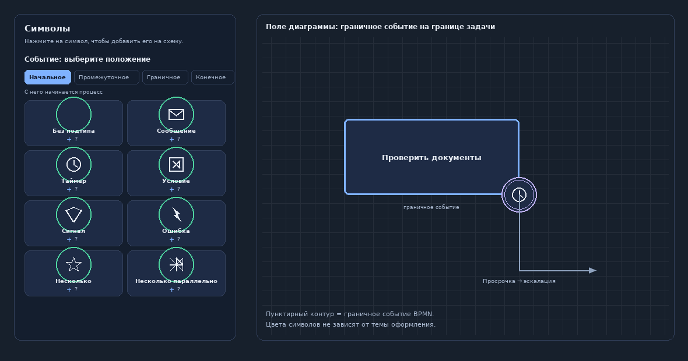
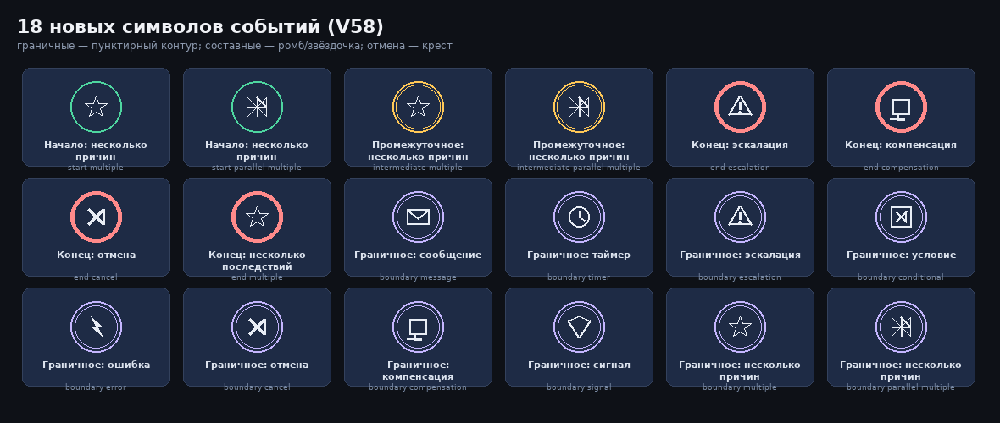

# BPMN шаг 2: палитра вариантов событий (V58)

## Что сделано

### 1. Палитра вариантов

Событие в BPMN описывается тремя вещами: **положение** (начальное,
промежуточное, граничное, конечное), **подтип** (сообщение, таймер,
ошибка…) и для промежуточных — **поведение** (ждём событие или
сообщаем о нём).

В палитре редактора теперь две ступени: сначала вкладка положения,
затем карточки подтипов с миниатюрой, названием, кнопкой «добавить» и
кнопкой подсказки. Запоминать коды символов не нужно.

Код символа остаётся прежним (`START_TIMER`, `INTERMEDIATE_MESSAGE`…),
поэтому сохранённые диаграммы открываются без миграции.

### 2. Восемнадцать новых символов

| Что | Символы |
|---|---|
| Составные события (несколько причин) | `START_MULTIPLE`, `START_PARALLEL_MULTIPLE`, `INTERMEDIATE_MULTIPLE`, `INTERMEDIATE_PARALLEL_MULTIPLE`, `END_MULTIPLE`, `BOUNDARY_MULTIPLE`, `BOUNDARY_PARALLEL_MULTIPLE` |
| Отмена | `END_CANCEL`, `BOUNDARY_CANCEL` |
| Граничные события | `BOUNDARY_MESSAGE`, `BOUNDARY_TIMER`, `BOUNDARY_ESCALATION`, `BOUNDARY_CONDITIONAL`, `BOUNDARY_ERROR`, `BOUNDARY_COMPENSATION`, `BOUNDARY_SIGNAL` |
| Конечные | `END_ESCALATION`, `END_COMPENSATION` |

Всего в каталоге теперь **61 символ** (43 из V55 + 18), события — 38.

### 3. Граничные события — отдельный режим

- Отдельная вкладка «Граничное» с пояснением «Крепится к границе задачи
  или подпроцесса — сначала выделите задачу на схеме».
- Рисуются двумя пунктирными кругами, как принято в BPMN 2.0.
- У граничных нет варианта «без подтипа»: граничному событию нужна причина.
- Цвет контура у всех граничных один (`#C4B5FD`, контраст 8.89:1 на фоне
  нотации) — тип различается пиктограммой, а не цветом. Иначе «таймер» и
  «ошибка» выглядели бы как события разных положений.
- При добавлении из палитры редактор подсказывает, что событие крепится
  к задаче.

## Совместимость

- 43 кода V55 не тронуты, подписи не переписаны.
- Реализация события (`_EVENT_SPEC`) расширена: в ней 38 записей, по одной
  на каждый вариант.
- Цвета символов по-прежнему не зависят от темы оформления: фон нотации
  единый `#17202C` (требование из V57).

## Что проверено

| Что | Статус |
|---|---|
| Таблица «положение + подтип» | 38 вариантов, ни одного без символа |
| Рисование каждого из 18 символов | проверено тестом по каждому коду |
| Старые коды и подписи V55 на месте | проверено тестом |
| Цвет и пунктир граничных | проверено тестом |
| Тесты | **275 пройдено** (было 169) |
| ruff | чисто |
| Палитра в браузере | **не проверено** — браузера в песочнице нет |
| Сборка EXE | не проверялось |

## Что осталось по нотации

Пункт шага 2 закрыт. Следующим по плану пользователя идёт реворк
объектов, но перед ним стоит проверить палитру в живом редакторе:
в песочнице нет браузера, поэтому «нажимается ли вкладка» проверено
только симулятором NiceGUI, а не реальным кликом.
