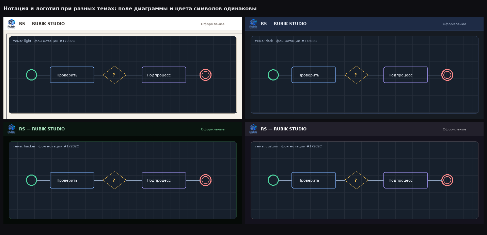

# Нотация и логотип при темах V57



## Два требования пользователя

1. **Цвета символов нотаций меняться не должны.**
2. **Логотип обязателен.**

## 1. Нотация не зависит от темы

Введён явный контракт вместо случайного совпадения:

- `NOTATION_CANVAS_BG = "#17202C"` — фон поля диаграммы, **одинаковый во
  всех четырёх темах**;
- `canvas_bg` и `canvas_node` у всех тем равны этой константе, сетка —
  `#252D39` (тот же фон, осветлённый на 6 %);
- цвета символов остаются в `bpmn_shapes_v55.COLOR` и от темы не зависят:
  старт `#4ED6A0`, конец `#FF8A8A`, промежуточное `#FFC857`,
  задача `#7FB2FF`, подпроцесс `#A99BFF`, шлюз `#FFC857`, данные `#BFD4EE`,
  дорожка `#8FA3BF`.

Тема перекрашивает интерфейс вокруг поля (меню, карточки, таблицы, кнопки),
но не само полотно и не символы.

Контраст символов на фоне нотации `#17202C`:

| Символ | Контраст |
|---|---|
| старт | 8.95:1 |
| конец | 7.23:1 |
| промежуточное / шлюз | 10.67:1 |
| задача | 7.59:1 |
| подпроцесс | 6.89:1 |
| данные | 10.84:1 |
| дорожка | 6.38:1 |

Это выше порога 3:1 для графических элементов (WCAG 1.4.11).
Проверяется тестами `tests/test_notation_and_logo_v57.py`.

## 2. Логотип

`tools/logo_prepare_F.py` собирает из исходника три файла:

| Файл | Что это | Где используется |
|---|---|---|
| `rubik_logo_light.png` | прозрачный фон, исходные цвета | светлая тема, главная страница |
| `rubik_logo_dark.png` | прозрачный фон, тёмные детали осветлены в фирменный синий | тёмная, hacker, «своя тёмная» |
| `rubik_logo_mark.png` | только знак куба без надписи | шапка (30 px) |

Почему понадобились отдельные файлы: исходник — 1254×1254 на сплошном
белом фоне. На тёмной теме он выглядел белым прямоугольником, а тёмно-синяя
надпись «Rubik STUDIO» на нём не читалась. В шапке при 30 px надпись всё
равно превращается в серое пятно, поэтому там показывается только куб.

Подстраховка (требование «логотип обязателен»):

1. штатный файл под тему;
2. если его нет — исходный `rubik_logo.png`;
3. если пропала вся папка `assets` — знак `R` в цветах темы (не пустое место).

## Состояние проверки

| Что | Статус |
|---|---|
| Код в исходниках | установлено |
| Тесты (169) | пройдены |
| Логотип по маршруту `/rs-branding/...` | проверено на живом сервере: `light → rubik_logo_light.png` (200), `dark/hacker/custom → rubik_logo_dark.png` (200), шапка настроек `→ rubik_logo_mark.png` (200) |
| Единый фон поля и цвета символов | проверено тестами и расчётом контраста |
| Вид логотипа в браузере | проверено макетом, **в браузере не проверялось** (браузер в песочнице недоступен) |
| Сборка EXE | не проверялось |

## Что править при замене логотипа

Положить новый файл в `rubik_studio/assets/rubik_logo.png` и выполнить:

```
python tools/logo_prepare_F.py
```

Скрипт заново соберёт три производные версии. Проверка наличия:
`python tools/logo_prepare_F.py --check`.
