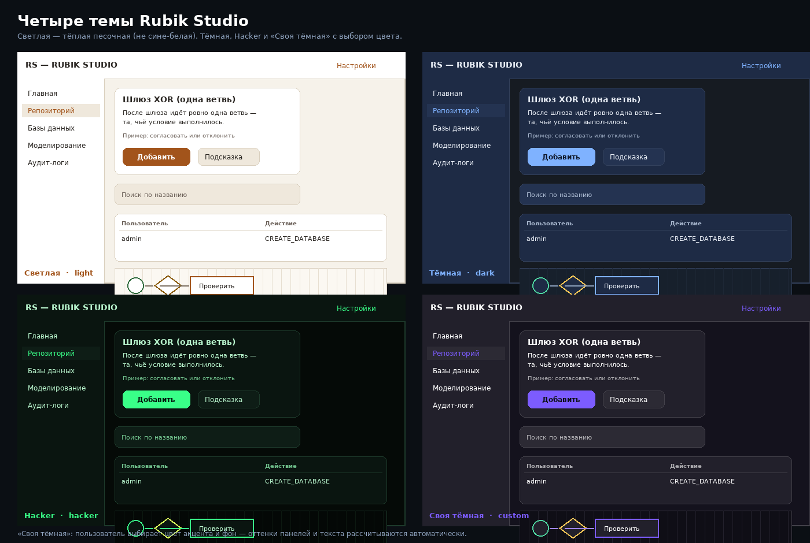

# Темы оформления V56 — макет на согласование

## Решение пользователя

Три темы с переключением плюс четвёртая «пользовательская тёмная», где
цвет выбирает сам пользователь. Светлая не должна быть бело-голубой.

## Что реализовано в коде

`rubik_studio/core/themes_v56.py`:

| Тема | Фон | Акцент | Назначение |
|---|---|---|---|
| `light` | `#F6F2EA` песочный | `#A2541B` охра | тёплая светлая, без синевы |
| `dark` | `#161B22` | `#7FB2FF` | нейтральная тёмная |
| `hacker` | `#050A07` | `#39FF88` | зелёный монохром, моноширинный шрифт |
| `custom` | задаёт пользователь | задаёт пользователь | остальные оттенки выводятся автоматически |

Проверено автотестами (`tests/test_themes_v56.py`, 49 проверок):

- контраст основного текста ≥ 4.5:1 во всех темах (WCAG AA);
- контраст подписей ≥ 4.5:1;
- текст на главной кнопке ≥ 4.4:1 при любом цвете акцента;
- светлая тема действительно тёплая: R > B и фон не белый;
- панели и рамки «своей тёмной» выводятся из фона и различимы.

## Вопросы на согласование

1. **Подходит ли тёплая светлая?** Альтернатива — тёплый серо-зелёный
   или бумажный с бежевым. Скажите, если нужен другой оттенок.
2. **Hacker: только для редактора диаграмм или для всего интерфейса?**
   Моноширинный шрифт во всех таблицах может быть неудобен именно
   возрастной аудитории.
3. **Своя тёмная: какие два параметра давать пользователю?** Сейчас
   предлагается цвет акцента и цвет фона. Можно добавить готовые
   пресеты (фиолетовый, изумрудный, янтарный).
4. **Где переключатель?** Предлагается в «Настройки» + быстрая кнопка
   в шапке.
