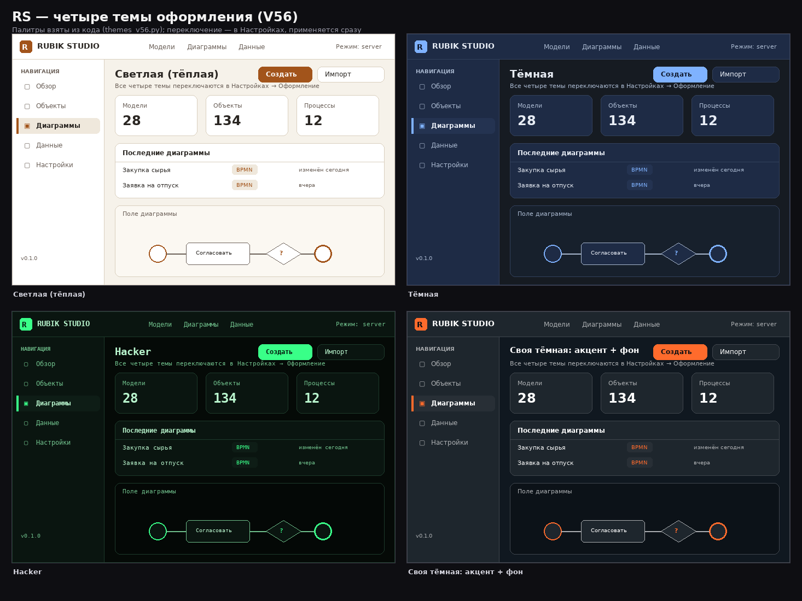

# Темы оформления V56

## Что решил пользователь

- Четыре темы: **светлая (тёплая, не бело-голубая)**, **тёмная**, **hacker**,
  **своя тёмная**; переключаются все четыре.
- Hacker применяется **ко всему интерфейсу**, а не только к полотну диаграммы.
- В «своей тёмной» пользователь задаёт **два параметра**: цвет подсветки
  (акцент) и фон. Фон при этом остаётся тёмным.
- Переключатель живёт **только в Настройках**, кнопки в шапке нет.

## Палитры

| Тема | Фон | Панель | Акцент | Примечание |
|---|---|---|---|---|
| `light` | `#F6F2EA` песочный | `#FFFFFF` | `#A2541B` охра | тёплая, синевы нет |
| `dark` | `#161B22` | `#1E2B45` | `#7FB2FF` | нейтральная тёмная |
| `hacker` | `#050A07` | `#0A1510` | `#39FF88` | монохром + моноширинный шрифт |
| `custom` | задаёт пользователь | выводится из фона | задаёт пользователь | фон принудительно тёмный |

Расчётные значения для «своей тёмной»:

- панели: `mix(фон, #FFFFFF, 0.06)` и `0.10`, рамка — `0.20`;
- цвет текста: `readable_text_color(фон)`;
- слишком светлый фон затемняется: порог `DARKNESS_LIMIT = 60`
  (средняя яркость RGB). Примеры: `#FFFFFF → #3C3C3C`, `#7C5CFF → #2F2361`.

## Как это работает в коде

- `rubik_studio/core/themes_v56.py` — палитры, `build_css()`, расчёт
  контраста и нормализация фона. Без зависимости от NiceGUI, проверяется
  юнит-тестами.
- `rubik_studio/ui/theme.py` — `apply_theme()` (CSS в head страницы +
  `ui.dark_mode`) и `apply_theme_live()` (перекраска открытой страницы без
  перезагрузки).
- `rubik_studio/ui/layout.py` — тема применяется на каждой странице,
  добавлены стили шапки и бокового меню с подсветкой активного пункта.
- `rubik_studio/ui/pages/settings.py` — блок «Оформление»: список тем,
  образец-свотч, два поля цвета, живое превью, расчёт контраста,
  кнопки «Применить свою тему» и «Сбросить к тёмной».
- `rubik_studio/config.py` — `theme`, `theme_accent`, `theme_background`
  в `config.json`. Мусор в этих полях не ломает запуск: откат на тёмную.

## Состояние проверки

| Что | Статус |
|---|---|
| Код в исходниках | установлено |
| Палитры и контраст | проверено автотестами |
| CSS и `dark_mode` на странице | проверено автотестами + в живом сервере (HTML страницы `/settings`) |
| Переключение в браузере (клик по списку) | **не проверено** — браузер в песочнице недоступен |
| Сборка EXE | не проверялось |

Контраст основного текста: light 13.45:1, dark 14.71:1, hacker 16.27:1,
custom до 18.52:1. Подписи: 5.47–9.02:1, текст на кнопке ≥ 4.4:1 при
акцентах `#FF6B2C`, `#00E5FF`, `#FFFFFF`, `#000000`, `#7C5CFF`, `#39FF88`.

## Исправлено по ходу

1. CSS темы писался в `shared_head_html` — общую на процесс строку. При двух
   вкладках с разными темами последняя записавшая перекрашивала все страницы,
   а `<style id="rs-theme">` дублировался. Теперь CSS добавляется в head
   конкретной страницы.
2. Выбранная тема применялась только после F5. Теперь `apply_theme_live()`
   заменяет содержимое тега `<style>` и класс `body--dark` сразу, данные на
   странице не теряются.
3. Пометка «фон затемнён для читаемости» показывалась при любом вводе
   (сравнение `#101820` с `101820`). Цвета теперь сравниваются в одном виде.
